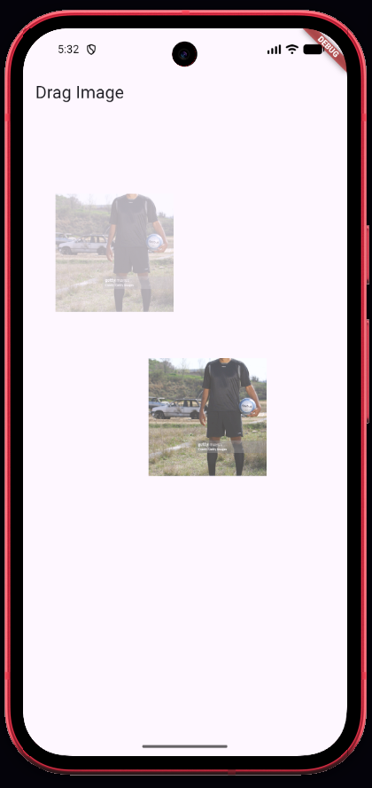

# LongPressDraggable

A small Flutter demo that lets you long-press an image and drag it around a canvas.

## Run it

```sh
flutter pub get
flutter run -d [your emulator id]
```

## Three attributes on `LongPressDraggable` widget

- `child`: the static widget/element shown on screen when not dragging (Before the dragging begins).
- `childWhenDragging`: the placeholder left behind while the `child` widget is being dragged (when not provided, `child` is the default).
- `feedback`: the floating copy that follows your finger when dragging.


